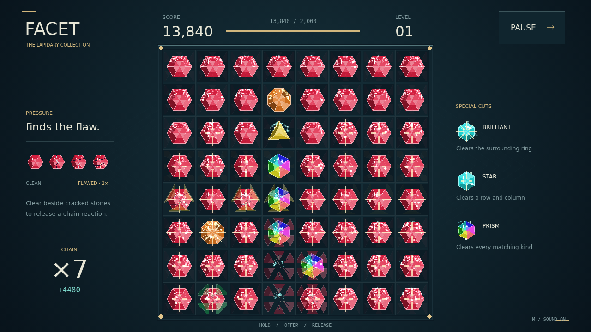

# Facet

Pressure finds the flaw. Take hold of a cut stone, carry it onto its neighbor, and let go. A line of three matching gems fractures into light, and the stones above drop into place. What lands may begin another clear — and another step up the chain.

The stones left standing remember. Every nearby clear deepens their cracks until they become flawed. Touch one with a clear and it shatters too, pulling the next flawed stone into the reaction and paying double. A quiet corner can become your most valuable move.

Longer lines leave something extraordinary. A brilliant takes the ring around it. A star cuts through its entire row and column. A prism, turned against another stone, releases every gem of that kind. Place these cuts beside a worn stretch of the board and watch the pressure travel.

Fill the level meter, count your longest chain and best move, then take on a fresh board with a higher target. Keep finding a way through until the stones offer no move left.

